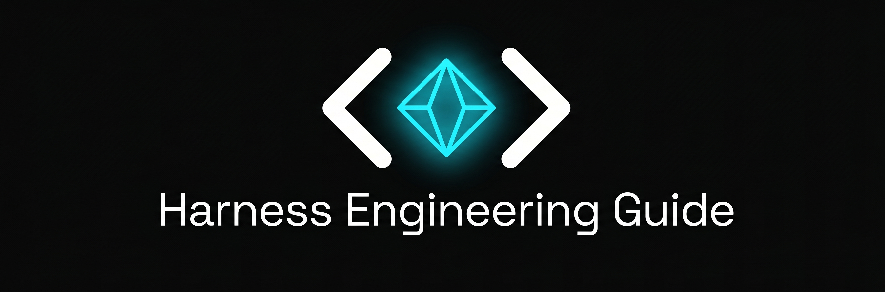

<p align="center">
  <a href="https://harness-guide.com/es/">
    
  </a>
</p>

<p align="center">
  <em>La guía práctica para construir harnesses de agentes de IA, con ejemplos de código reales que puedes copiar y ejecutar.</em>
</p>

<p align="center">
  <a href="https://github.com/nexu-io/harness-engineering-guide/stargazers"></a>
  <a href="https://github.com/nexu-io/harness-engineering-guide/blob/main/LICENSE"></a>
</p>

<p align="center">
  🌐 <b><a href="https://harness-guide.com/es/">Sitio en español</a></b> | <a href="https://harness-guide.com">English</a> | <a href="https://harness-guide.com/zh/">中文站</a>
</p>

<p align="center">
  <a href="README.md">English</a> | <a href="README.zh-CN.md">中文</a> | <b>Español</b>
</p>

---

Un **harness** es la capa de runtime que envuelve un modelo de lenguaje desnudo y lo convierte en un **agente**: un sistema autónomo capaz de percibir su entorno, tomar decisiones y ejecutar acciones a lo largo de varios pasos. El harness se encarga de todo lo que el modelo no puede hacer por sí solo: ejecutar herramientas, gestionar la memoria, ensamblar el contexto y hacer cumplir los límites de seguridad.

Esta guía cubre la ingeniería de harness desde los primeros principios hasta los patrones de producción, con código real en cada artículo.

---

## Primeros pasos

| Tema | Descripción |
|------|-------------|
| [¿Qué es un harness?](es-guide/what-is-harness.md) | El concepto en 3 minutos. Cómo convierte un modelo en un agente. Harness vs. framework vs. runtime. |
| [Tu primer harness](es-guide/your-first-harness.md) | Construye un harness funcional en 50 líneas de Python. Código completo que puedes copiar y ejecutar. |
| [Harness vs. framework](es-guide/harness-vs-framework.md) | Cuándo usar un harness propio y cuándo LangChain/CrewAI. Árbol de decisión + comparación de código lado a lado. |

## Conceptos clave

| Tema | Descripción |
|------|-------------|
| [Bucle agéntico](es-guide/agentic-loop.md) | El ciclo pensar → actuar → observar. Presupuesto de turnos, llamadas a herramientas en paralelo, detección de bucles, streaming. |
| [Sistema de herramientas](es-guide/tool-system.md) | Registro de herramientas, carga estática vs. dinámica, protocolo MCP, patrones para escribir buenas descripciones. |
| [Memoria y contexto](es-guide/memory-and-context.md) | Ensamblaje de contexto, gestión de sesiones, memoria en dos niveles (registros diarios + largo plazo). Patrones AGENTS.md y MEMORY.md. |
| [Guardrails](es-guide/guardrails.md) | Modelos de permisos, límites de confianza, sandboxing, defensa contra la inyección de prompts. |

## Práctica

| Tema | Descripción |
|------|-------------|
| [Ingeniería de contexto](es-guide/context-engineering.md) | Ensamblaje por prioridades, tres líneas de defensa para la compresión, presupuesto de tokens. |
| [Sandbox](es-guide/sandbox.md) | Configuraciones con Docker y Firecracker, aislamiento de red, restricciones del sistema de archivos. |
| [Sistema de skills](es-guide/skill-system.md) | Empaquetado de skills, carga bajo demanda, formato SKILL.md, harness ligero + skills densas. |
| [Subagentes](es-guide/sub-agent.md) | Patrón líder-trabajador, comunicación mediante archivos, aislamiento de sesión, ejecución en paralelo. |
| [Manejo de errores](es-guide/error-handling.md) | Clasificación de errores, estrategias de reintento, degradación elegante, checkpoints y reanudación. |
| [Orquestación multiagente](es-guide/multi-agent-orchestration.md) | Patrones de orquestación (pipeline, fan-out, supervisor), aislamiento de contexto, ejemplos reales (Multica, Paseo, OpenClaw). |
| [Programación de tareas y automatización](es-guide/scheduling-and-automation.md) | Cron, heartbeats, disparadores por eventos. Selección de sesión destino, entrega, LangSmith frente al enfoque nativo del harness. |
| [Diseño de harness de larga duración](es-guide/long-running-harness.md) | Ansiedad de contexto, sesgo de autoevaluación, reinicio de contexto vs. compactación, arquitectura generador-evaluador inspirada en las GAN. |
| [Arquitectura de Managed Agents](es-guide/managed-agents-architecture.md) | Desacoplar cerebro, manos y sesión; mascotas frente a ganado; aislamiento de credenciales; mejoras de TTFT. |
| [Ruido de infraestructura en evals](es-guide/eval-infrastructure.md) | La configuración de recursos mueve las puntuaciones de un benchmark hasta 6 pp. Estrategia de suelo + techo. |
| [Permisos basados en clasificadores](es-guide/classifier-permissions.md) | Sustituye la fatiga de aprobación por clasificadores basados en modelos. Defensa en dos capas, cuatro modelos de amenazas, diseño ciego al razonamiento. |
| [Eval awareness](es-guide/eval-awareness.md) | Cuando los agentes reconocen que están siendo evaluados. Un nuevo tipo de contaminación, amplificación en sistemas multiagente, defensas desde el harness. |
| [Agent Teams](es-guide/agent-teams.md) | 16 Claudes en paralelo construyeron un compilador de C de 100K líneas. Ralph-loop, coordinación basada en git, bisección con GCC como oráculo. |
| [Patrón Initializer + Coding Agent](es-guide/initializer-coding-pattern.md) | Harness en dos fases para agentes de larga duración. Lista de funcionalidades en JSON, ritual de arranque, commits en estado limpio. |

## Referencia

| Tema | Descripción |
|------|-------------|
| [Comparación de implementaciones](es-guide/comparison.md) | Comparación lado a lado de OpenClaw, Claude Code, Codex, Cline, Aider y Cursor. |
| [Glosario](es-guide/glossary.md) | Definiciones de los términos clave. |

## Casos reales

| Tema | Descripción |
|------|-------------|
| [Cómo lanzamos nuestro cliente para Windows](es-guide/nexu-windows-packaging.md) | Build de 15 min a 4 min, instalación de 10 min a 2 min. Cómo reconstruimos el pipeline de empaquetado de Electron. |
| [Caza de cuentas fantasma](es-guide/ghost-account-hunting.md) | Más de 1000 cuentas fantasma drenaron nuestra plataforma en 15 días. El post-mortem completo. |

---

## Cómo contribuir

1. Ve a [**Issues → New Issue**](https://github.com/nexu-io/harness-engineering-guide/issues/new/choose)
2. Elige **"📬 Submit a Resource"**
3. Completa el título, la URL y por qué es relevante

O envía un PR directamente; consulta [CONTRIBUTING.md](CONTRIBUTING.md) (en inglés).

---

## Comunidad

- 💬 **GitHub Discussions**: [únete a la conversación](https://github.com/nexu-io/harness-engineering-guide/discussions)
- 🐦 **Twitter**: [@nexudotio](https://x.com/nexudotio)
- 💬 **Grupo de Feishu** (en chino): [únete al grupo de Harness Engineering](https://applink.feishu.cn/client/chat/chatter/add_by_link?link_token=717g465a-0bc8-4242-9281-12b23953491a)

---

## Acerca de

Mantenida por [Nexu](https://github.com/nexu-io), la plataforma open source de Claude Co-worker y Managed Agents.

## Licencia

[Licencia MIT](LICENSE)

---

Si esta guía te resulta útil, considera darle una ⭐

```
@misc{nexu_harness-engineering-guide_2026,
  author = {Nexu Team},
  title = {Harness Engineering Guide},
  year = {2026},
  publisher = {GitHub},
  howpublished = {\url{https://github.com/nexu-io/harness-engineering-guide}}
}
```
