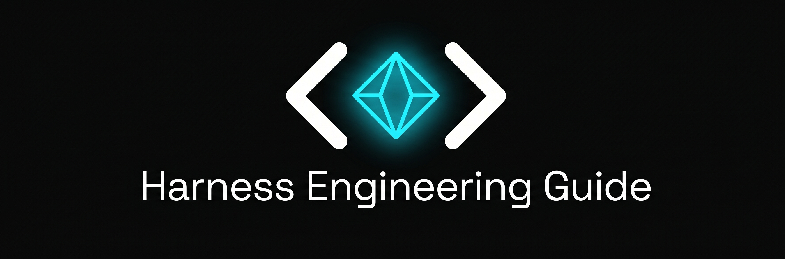

<p align="center">
  <a href="https://harness-guide.com/zh/">
    
  </a>
</p>

<p align="center">
  <em>構建 AI Agent Harness 的實戰指南——每篇文章都有可複製執行的真實程式碼。</em>
</p>

<p align="center">
  <a href="https://github.com/nexu-io/harness-engineering-guide/stargazers"></a>
  <a href="https://github.com/nexu-io/harness-engineering-guide/blob/main/LICENSE"></a>
</p>

<p align="center">
  🌐 <b><a href="https://harness-guide.com/zh/">中文站</a></b> | <a href="https://harness-guide.com">English</a>
</p>

<p align="center">
  <a href="README.md">English</a> | <a href="README.zh-CN.md">简体中文</a> | <b>繁體中文</b>
</p>

---

**Harness** 是將裸語言模型變成 **Agent** 的 Runtime 封裝層——一個能夠感知環境、做出決策、跨多個步驟執行操作的自主系統。Harness 處理模型自身無法完成的一切：執行工具、管理記憶、組裝上下文、執行安全邊界。

本指南從第一性原理到生產模式覆蓋 Harness Engineering，每篇文章都有真實程式碼。

---

## 入門

| 主題 | 描述 |
|------|------|
| [什麼是 Harness？](zh-TW-guide/what-is-harness.md) | 3 分鐘理解概念。如何將模型變成 Agent。Harness vs Framework vs Runtime。 |
| [你的第一個 Harness](zh-TW-guide/your-first-harness.md) | 50 行 Python 構建可執行的 Harness。可複製執行的完整程式碼。 |
| [Harness 與 Framework 的區別](zh-TW-guide/harness-vs-framework.md) | 何時用原始 Harness vs LangChain/CrewAI。決策樹 + 程式碼對比。 |

## 核心概念

| 主題 | 描述 |
|------|------|
| [Agentic Loop](zh-TW-guide/agentic-loop.md) | Think → Act → Observe 迴圈。Turn 預算、並行 Tool 呼叫、迴圈檢測、流式傳輸。 |
| [Tool 系統](zh-TW-guide/tool-system.md) | Tool 註冊表、靜態 vs 動態載入、MCP 協議、描述品質模式。 |
| [Memory 與 Context](zh-TW-guide/memory-and-context.md) | Context 組裝、Session 管理、雙層 Memory。AGENTS.md 和 MEMORY.md 模式。 |
| [Guardrails](zh-TW-guide/guardrails.md) | 權限模型、信任邊界、沙箱、Prompt 注入防禦。 |

## 實戰

| 主題 | 描述 |
|------|------|
| [Context 工程](zh-TW-guide/context-engineering.md) | 優先順序組裝、壓縮三道防線、Token 預算。 |
| [Sandbox](zh-TW-guide/sandbox.md) | Docker 和 Firecracker 配置、網路隔離、檔案系統限制。 |
| [Skill 系統](zh-TW-guide/skill-system.md) | Skill 打包、按需載入、SKILL.md 格式、薄 Harness + 厚 Skill。 |
| [Sub-Agent](zh-TW-guide/sub-agent.md) | Leader-Worker 模式、檔案通訊、Session 隔離、並行執行。 |
| [錯誤處理](zh-TW-guide/error-handling.md) | 錯誤分類、重試策略、優雅降級、斷點續傳。 |
| [多 Agent 編排](zh-TW-guide/multi-agent-orchestration.md) | 編排模式（流水線、扇出、監督者），Context 隔離，實戰案例（Multica、Paseo、OpenClaw）。 |
| [定時任務與自動化](zh-TW-guide/scheduling-and-automation.md) | Cron、Heartbeat、事件觸發。Session 目標、交付、LangSmith vs Harness 原生對比。 |
| [長時執行 Harness 設計](zh-TW-guide/long-running-harness.md) | Context 焦慮、自評估偏差、Reset vs Compaction、GAN 啟發的生成器-評估器架構。 |
| [Managed Agents 架構](zh-TW-guide/managed-agents-architecture.md) | Brain/Hands/Session 三層解耦、Pets vs Cattle、憑證隔離、TTFT 改進。 |
| [評測基礎設施噪聲](zh-TW-guide/eval-infrastructure.md) | 資源配置導致 Benchmark 得分波動 6 個百分點。Floor+Ceiling 執行策略。 |
| [基於分類器的權限審批](zh-TW-guide/classifier-permissions.md) | 用模型分類器替代 approval fatigue。雙層防禦、四種威脅模型、reasoning-blind 設計。 |
| [Eval Awareness](zh-TW-guide/eval-awareness.md) | Agent 意識到被評估時的行為。新型 contamination、Multi-Agent 放大效應、Harness 防禦。 |
| [Agent Teams](zh-TW-guide/agent-teams.md) | 16 個並行 Claude 造 100K 行 C 編譯器。Ralph-loop、Git 協調、GCC-as-oracle 二分法。 |
| [Initializer + Coding Agent 模式](zh-TW-guide/initializer-coding-pattern.md) | 長時執行 Agent 的兩階段 Harness。Feature list JSON、啟動儀式、Clean state commit。 |

## 參考

| 主題 | 描述 |
|------|------|
| [主流 Harness 實現對比](zh-TW-guide/comparison.md) | OpenClaw、Claude Code、Codex、Cline、Aider、Cursor 並排對比。 |
| [術語表](zh-TW-guide/glossary.md) | 關鍵術語定義。 |

## 分享

| 主題 | 描述 |
|------|------|
| [Windows 客戶端百億 Token 實戰](zh-TW-guide/nexu-windows-packaging.md) | 打包 15min→4min，安裝 10min→2min。Electron 打包流水線重建全記錄。 |
| [1000+ 幽靈帳號盜刷排查實錄](zh-TW-guide/ghost-account-hunting.md) | 上線 15 天被盜刷 1000+ 帳號的血淚排查全過程。 |

---

## 如何貢獻

1. 進入 [**Issues → New Issue**](https://github.com/nexu-io/harness-engineering-guide/issues/new/choose)
2. 選擇 **"📬 Submit a Resource"**
3. 填寫標題、連結和推薦理由

也可以直接提交 PR——參見 [CONTRIBUTING.md](CONTRIBUTING.md)。

---

## 社群

- 💬 **GitHub Discussions** — [參與討論](https://github.com/nexu-io/harness-engineering-guide/discussions)
- 🐦 **Twitter** — [@nexudotio](https://x.com/nexudotio)
- 💬 **飛書群** — [加入 Harness Engineering 話題群](https://applink.feishu.cn/client/chat/chatter/add_by_link?link_token=717g465a-0bc8-4242-9281-12b23953491a)

---

## 關於

由 [Nexu](https://github.com/nexu-io) 維護——開源的 Claude Co-worker & Managed Agent 平臺。

## 許可證

[MIT License](LICENSE)

---

如果覺得這份指南有用，請考慮給個 ⭐

```
@misc{nexu_harness-engineering-guide_2026,
  author = {Nexu Team},
  title = {Harness Engineering Guide},
  year = {2026},
  publisher = {GitHub},
  howpublished = {\url{https://github.com/nexu-io/harness-engineering-guide}}
}
```
